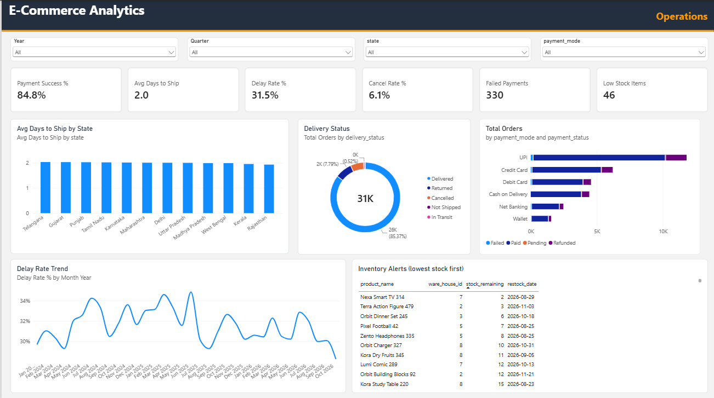
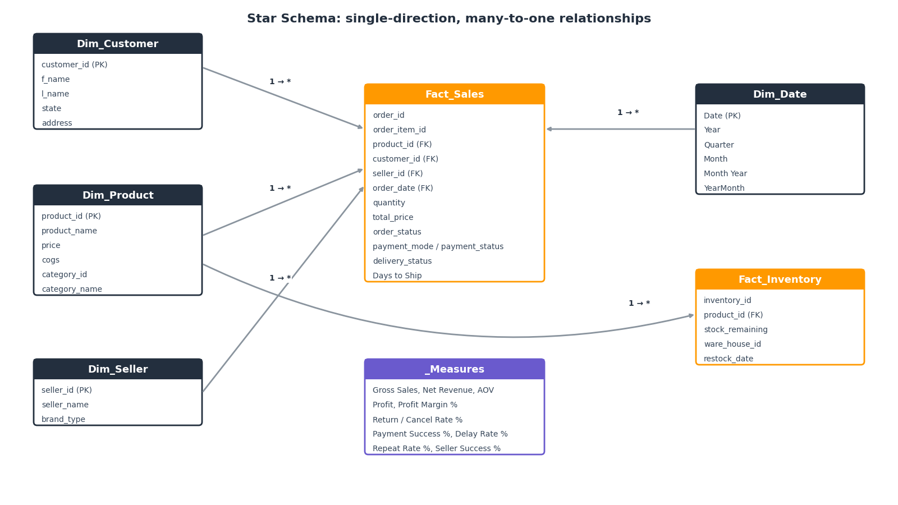
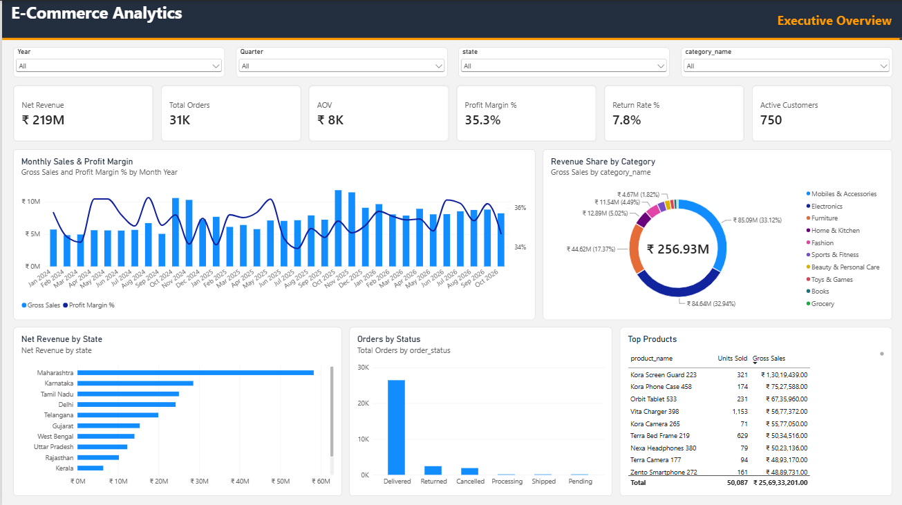
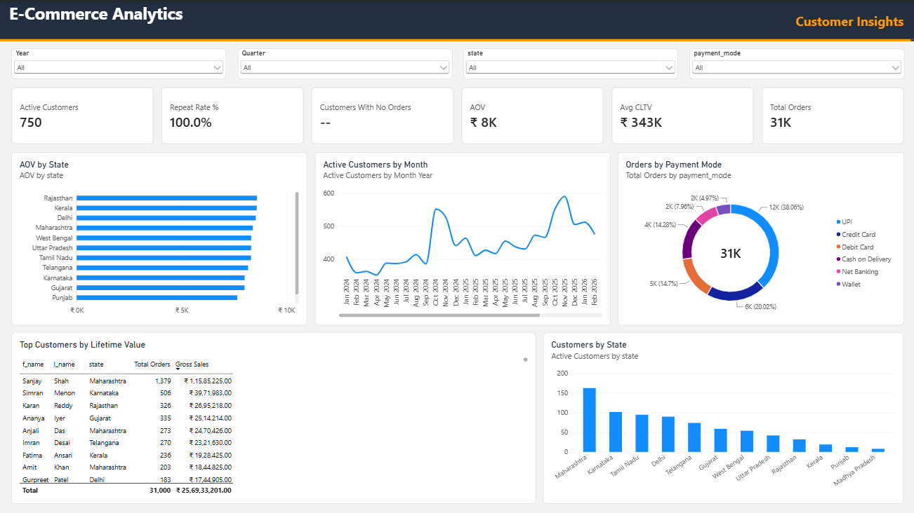
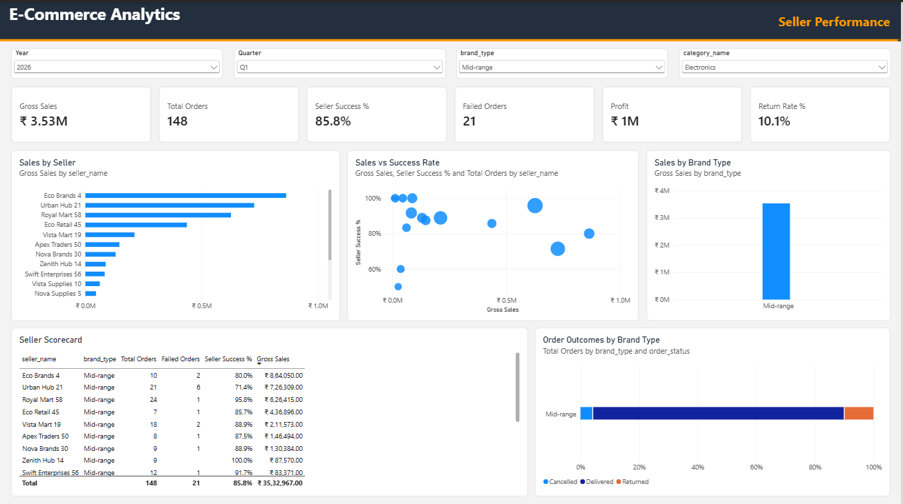

# E-Commerce Sales Analytics Dashboard (SQL + Power BI)

An end-to-end analytics project on a marketplace dataset: SQL exploration and business-question analysis, followed by a multi-page Power BI dashboard built on a star-schema data model with DAX measures.

<p align="center">
  
</p>

---

## Table of contents
1. [Project overview](#project-overview)
2. [Dataset](#dataset)
3. [Tech stack](#tech-stack)
4. [Data model](#data-model)
5. [Dashboard pages](#dashboard-pages)
6. [Key metrics and DAX](#key-metrics-and-dax)
7. [SQL analysis](#sql-analysis)
8. [Key findings](#key-findings)
9. [Project structure](#project-structure)
10. [How to run](#how-to-run)
11. [Future improvements](#future-improvements)

---

## Project overview

The goal is to answer common business questions for an online marketplace (sales, products, customers, operations, sellers) and present the answers in an interactive dashboard that a business team could use day to day.

**Workflow**
1. Explore the 9 source tables with SQL (EDA).
2. Answer 11+ business questions with advanced SQL (window functions, CTEs, ranking, `LAG`).
3. Clean and model the data in Power Query as a star schema.
4. Write reusable DAX measures.
5. Build five themed dashboard pages with slicers, KPI cards and charts.

---

## Dataset

| Table | Description |
|---|---|
| `orders` | One row per order: date, customer, seller, status |
| `order_items` | Product, quantity, price and total per order |
| `payments` | Payment mode, status and date |
| `shipping` | Shipping date, delivery status, return date |
| `customers` | Customer name and state |
| `products` | Product name, price and cost of goods (`cogs`) |
| `category` | Product categories |
| `sellers` | Seller name and brand type |
| `inventory` | Stock remaining, warehouse and restock date |

**Scale:** 31,000 orders, 50,087 units sold, 750 active customers across 12 states, 60 sellers, order dates from 1 Jan 2024 to 19 Oct 2026.

---

## Tech stack

- **SQL (PostgreSQL syntax):** joins, CTEs, window functions (`RANK`, `LAG`), aggregations
- **Power BI Desktop:** Power Query (M), data modeling, DAX, report design
- **Power BI Project (PBIP) format:** text-based, version-control friendly

---

## Data model

`orders`, `order_items`, `payments` and `shipping` are 1:1 on `order_id`, so they are merged in Power Query into one fact table, `Fact_Sales`, with a calculated `Days to Ship` column. This gives a simple star schema:

```
Dim_Customer ─┐
Dim_Product  ─┼──►  Fact_Sales  ◄── Dim_Date
Dim_Seller   ─┘

Dim_Product ──►  Fact_Inventory
```

All relationships are many-to-one with single-direction filtering. A dedicated `Dim_Date` table is marked as the date table to support time intelligence.

<p align="center">
  
</p>

---

## Dashboard pages

Each page shares the same layout: header, four slicers, six KPI cards and five visuals.

### 1. Executive Overview
High-level KPIs: net revenue, orders, AOV, profit margin, return rate, active customers. Monthly sales with profit-margin line, revenue share by category, sales by state, orders by status, top products.

<p align="center">
  
</p>

### 2. Product & Category
Category treemap, profit by category, sales trend, state-by-category matrix, product performance table.

<p align="center">
  
</p>

### 3. Customer Insights
Repeat rate, customers with no orders, average lifetime value, AOV by state, payment-mode mix, top customers table.

<p align="center">
  
</p>

### 4. Operations
Payment success rate, shipping delays, cancellations, failed payments and low-stock alerts, with delivery status and delay-rate trend.

<p align="center">
  
</p>

### 5. Seller Performance
Seller scorecard, sales versus success rate, performance by brand type, order outcomes by brand.

<p align="center">
  
</p>

---

## Key metrics and DAX

| Measure | Logic |
|---|---|
| Gross Sales | `SUM ( Fact_Sales[total_price] )` |
| Net Revenue | Gross sales on `Delivered` orders only |
| AOV | `DIVIDE ( [Gross Sales], [Total Orders] )` |
| Profit / Profit Margin % | Net revenue minus delivered COGS (`quantity * cogs`) |
| Return Rate % / Cancel Rate % | Share of orders with status `Returned` / `Cancelled` |
| Payment Success % | Share of orders with payment status `Paid` |
| Delay Rate % | Share of orders shipped more than 2 days after the order date |
| Repeat Rate % | Customers with more than one order / active customers |
| Net Revenue YoY % | Compares with the same period last year, only when a single year is selected |
| Seller Success % | Share of a seller's orders that were delivered |

```dax
Delivered COGS =
CALCULATE (
    SUMX ( Fact_Sales, Fact_Sales[quantity] * RELATED ( Dim_Product[cogs] ) ),
    Fact_Sales[order_status] = "Delivered"
)

Profit Margin % = DIVIDE ( [Profit], [Net Revenue] )
```

---

## SQL analysis

Business questions answered before building the dashboard (see `sql/queries.sql`):

1. Top 10 products by sales value
2. Revenue by category with percentage contribution
3. Average order value per customer
4. Monthly sales trend with previous-month comparison (`LAG`)
5. Customers who never placed an order
6. Least-selling category in each state (`RANK` + CTE)
7. Customer lifetime value ranking
8. Low-stock inventory alerts
9. Shipping delays (more than 2 days)
10. Payment success rate by status
11. Top sellers by sales and success rate *(in progress)*

---

## Key findings

All figures come from the dataset (1 Jan 2024 to 19 Oct 2026).

- **Scale:** 31,000 orders with gross sales of about ₹25.69 crore (₹256.9M) and an AOV of roughly ₹8,288.
- **Revenue and profit:** Delivered orders generate ₹21.9 crore (₹219.1M) of net revenue at a **35.3% profit margin**.
- **Growth:** Net revenue grew about **22%** from 2024 (₹66.7M) to 2025 (₹81.6M). 2026 is a partial year (₹70.8M through October).
- **Order quality:** 85.4% of orders are delivered, 7.8% are returned and 6.1% are cancelled.
- **Payments:** 84.8% of orders have a successful (`Paid`) payment, and 330 payments failed.
- **Fulfilment:** About 31.5% of shipped orders ship later than 2 days, even though the average is 2.0 days, so delays are broad rather than driven by a few states.
- **Inventory:** 46 product-warehouse records are below the 50-unit threshold, with the lowest at 2 units.

> **Data note:** `payments` has 4,293 `Refunded` rows, but only 2,415 orders are marked `Returned`. This difference is worth validating with the data owner.

---

## Project structure

```
.
├── README.md
├── assets/                       # dashboard screenshots (PNG)
├── sql/
│   └── queries.sql               # EDA and business-question queries
├── data/                         # source CSV files
├── amazon_dashboard_final.pbip   # open this in Power BI Desktop
├── amazon_dashboard_final.Report/
└── amazon_dashboard_final.SemanticModel/
```

---

## How to run

1. Install **Power BI Desktop** (Windows).
2. Clone or download this repository.
3. Open `amazon_dashboard_final.pbip`.
4. In **Transform data**, update the CSV folder path if needed, then click **Refresh**.
5. Use the page tabs at the bottom to move between dashboards.

---

## Future improvements

- Add a state map once state names are assigned a geographic data category
- Make the low-stock threshold and delay threshold adjustable with What-if parameters
- Add Top N filters on product, customer and seller visuals
- Add drill-through from a customer or seller to their order history
- Add row-level security for seller-specific views
- Schedule refresh after moving the data to a database

---

## Author

**Your Name**  ·  [LinkedIn](https://www.linkedin.com/) · [GitHub](https://github.com/)
